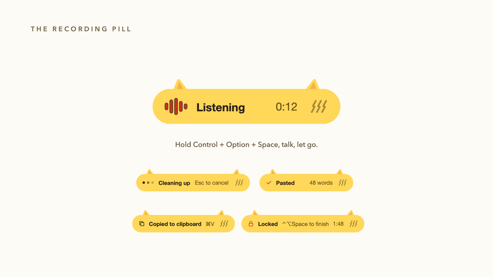
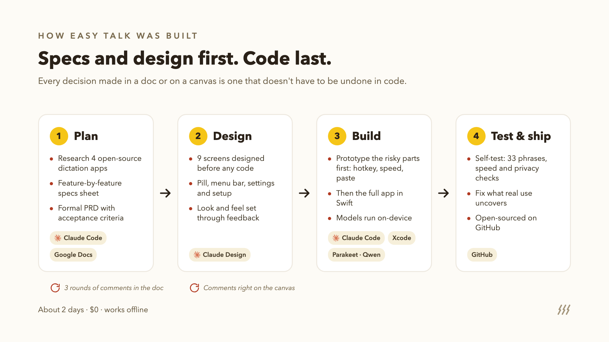
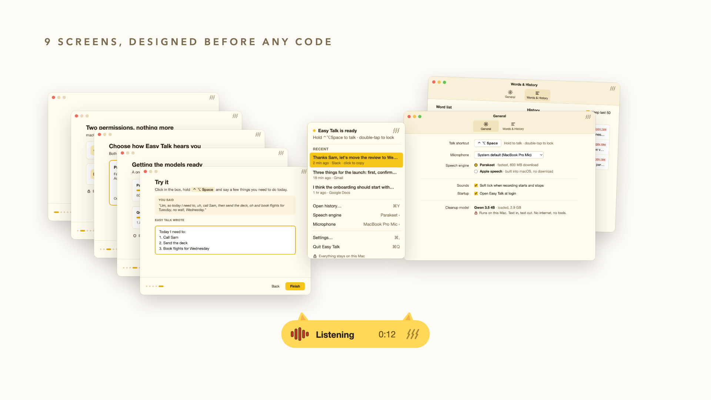

# Easy Talk

A personal proof of concept for on-device dictation on macOS, built around one specific workflow. Hold **Control + Option + Space**, speak, and release: the speech is transcribed locally, cleaned up (filler words removed, self-corrections resolved, lists and paragraphs formatted) and pasted at the cursor.



> **Not maintained.** This repository is archived. It is shared as-is for reference; issues and pull requests are not accepted. Mature tools already cover this space, including [Wispr Flow](https://wisprflow.ai), [FluidVoice](https://github.com/altic-dev/FluidVoice), [VoiceInk](https://github.com/Beingpax/VoiceInk) and [Handy](https://github.com/cjpais/Handy). For everyday use, start there.
>
> Easy Talk is an independent project and isn't affiliated with or endorsed by Wispr Flow or any other company mentioned here.

## Requirements
- Apple Silicon Mac
- macOS 26 or later
- About 4 GB of free disk space for the models

## Install
1. Download `Easy-Talk-0.1.0.zip` from [Releases](https://github.com/coreyashmeade/easy-talk/releases), unzip it and move **Easy Talk** to Applications.
2. Open it. The app isn't notarized by Apple, so macOS blocks the first launch. Click **Done**, then open **System Settings → Privacy & Security**, scroll to **Security** and click **Open Anyway** next to Easy Talk. This is needed once.
3. Follow setup: grant Microphone and Accessibility access, choose a speech engine, and let the models download (about 3.5 GB) and load.

To verify the download, compare its SHA-256 with the checksum published on the release page: `shasum -a 256 Easy-Talk-0.1.0.zip`.

## Use
- **Hold** Control + Option + Space, speak, release. The text is pasted at the cursor.
- **Double-tap** the shortcut to keep recording hands-free; press it once more to finish.
- **Esc** cancels.
- If no text field is focused, the text is copied to the clipboard instead.
- Spoken commands: "new paragraph", "new line", "bullet".
- The menu bar icon switches between the Parakeet and Apple speech engines.

## Privacy and security
- **On-device.** Speech recognition and cleanup run locally. The only network access is the one-time model download from Hugging Face. Every file is checked against a pinned SHA-256 checksum, and a file that doesn't match is rejected.
- **No data kept.** Audio stays in memory and is discarded after transcription. Dictated text is not stored. The log at `~/Library/Logs/EasyTalk.log` records timings and errors only. There are no accounts, analytics or telemetry.
- **Contained model.** The cleanup model only transforms text. It has no tools and no access to files, the screen or other apps. If its output doesn't match what was said, the raw transcript is pasted instead.
- **Permissions.**
  - *Microphone:* only while the shortcut is held, with an on-screen indicator.
  - *Accessibility:* used to detect the shortcut (the app watches key presses but acts only on Control + Option + Space and Esc) and to paste. It reads the type of the focused field, never its contents.
  - *Speech Recognition:* only if the Apple engine is chosen.

## Uninstall
```bash
rm -rf "/Applications/Easy Talk.app" "$HOME/Library/Application Support/EasyTalk" "$HOME/Library/Logs/EasyTalk.log"
defaults delete com.coreyashmeade.easytalk
tccutil reset All com.coreyashmeade.easytalk
```

## Build from source
Requires Xcode 27 with the Metal Toolchain (`xcodebuild -downloadComponent MetalToolchain`).
```bash
cd app
./build.sh --run
```
`build.sh` signs with an "Apple Development" identity by default; set `SIGN_IDENTITY` to use another. To package an ad-hoc signed release zip: `scripts/package-release.sh`.

Self-test (runs the full pipeline on synthesized speech without pressing keys or pasting):
```bash
"app/build/Easy Talk.app/Contents/MacOS/EasyTalk" --selftest tests/cleanup-cases.json
```

## Status and future work
Complete as a proof of concept (v0.1.0). The core loop is built and verified (`docs/m3-results.md`). Designed but not built:
- A settings window: shortcut, microphone, sounds and launch at login
- A custom word list editor (the word list can be set with `defaults write com.coreyashmeade.easytalk wordList -array <words>`)
- Dictation history
- Silence trimming within recordings

## How it was built
Specs and design came before code: research and a PRD reviewed in a doc, screens designed and reviewed on a canvas, the riskiest parts prototyped, then the app built and tested.



## Design
All screens were designed before any code was written. The settings and history screens were designed but not built.



## Documentation
| Doc | Contents |
|---|---|
| `docs/prd.md` | Requirements and delivery status |
| `docs/m2-results.md`, `docs/m3-results.md` | Test results |
| `docs/build-plan.md` | Milestones |
| `docs/design/` | UI design source files |
| `docs/research.md` | Comparable tools and model options |
| `docs/licenses.md` | Third-party licenses |
| `decisions.md` | Decision log |

## License
MIT. See `LICENSE`. Third-party license texts are in `THIRD_PARTY_NOTICES.md` (also included in the app at `Easy Talk.app/Contents/Resources/`); a summary of obligations is in `docs/licenses.md`.

## Acknowledgements
- Speech recognition: [Parakeet TDT 0.6B v2](https://huggingface.co/nvidia/parakeet-tdt-0.6b-v2) by NVIDIA, licensed under [CC-BY-4.0](https://creativecommons.org/licenses/by/4.0/), run with [FluidAudio](https://github.com/FluidInference/FluidAudio) (Apache 2.0)
- Text cleanup: [Qwen 3.5 4B](https://huggingface.co/mlx-community/Qwen3.5-4B-MLX-4bit) (Apache 2.0), run with [mlx-swift-lm](https://github.com/ml-explore/mlx-swift-lm) (MIT)
- Research references: VoiceInk, Handy, OpenWhispr and FluidVoice
